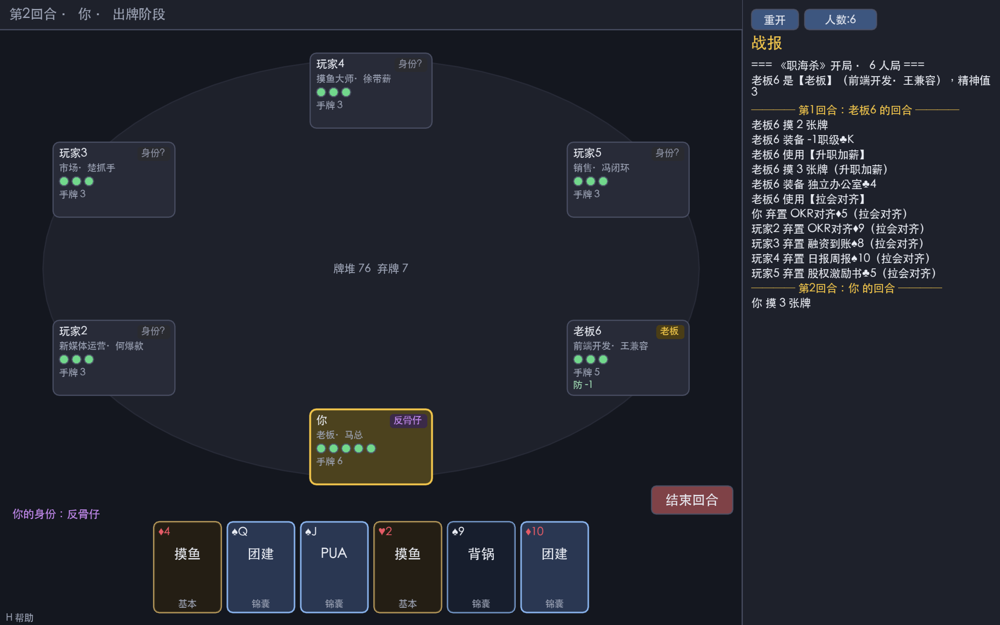

# 《职海杀》— love2d 实现

把上级目录里的策划案（`00_职海杀_主策划案.md`、`01_完整卡牌数值表.md`）做成了一个可玩的
**love2d（LÖVE 11.x）单机对战版**：你 1 人 + 多个 AI 的身份局。



## 运行

```bash
# 方式一：脚本（自动找 love 或 /Applications/love.app）
./run.sh

# 方式二：手动
love .                       # 需要 love 在 PATH 中
/Applications/love.app/Contents/MacOS/love .   # macOS 直接调用
```

需要安装 LÖVE 11.x：
- macOS：`brew install --cask love`，或 https://love2d.org 下载 `love.app` 放到 `/Applications`
- Linux：`sudo apt install love`
- Windows：从 https://love2d.org 下载，`love.exe 游戏目录`

> 中文字体在运行时从系统字体自动加载（macOS 用华文黑体 / 苹方 / Arial Unicode，
> Linux 用 Noto/文泉驿，Windows 用微软雅黑/黑体），无需自带字体文件。

## 玩法 / 操作

- **身份**：老板（公开）/ 嫡系 / 摸鱼党 / 反骨仔，胜利条件见策划案 §4.1。
- **回合**：判定 → 摸 2 张 → 出牌 → 弃牌（弃到等于精神值）→ 结束。
- **基本牌**：加班(杀) / 摸鱼(闪) / 画饼(桃) / 卷一下(酒)。
- **操作**：
  - 点手牌出牌；需要指定目标时，可点的目标会高亮，点击目标即可。
  - 左下角 `技·xxx` 按钮发动主动技；右下 `结束回合` 结束出牌阶段。
  - 被【加班】等指定时，弹出选择：点【摸鱼】响应，或点「取消/跳过」承受。
  - 顶部 `人数` 按钮切换 4–8 人并重开；`重开` 重新发牌。
  - `H` 帮助，`R` 重开，`Esc` 退出，鼠标滚轮翻战报。

## 架构

纯 Lua 规则引擎与渲染解耦，引擎不依赖 `love`，因此可脱离 LÖVE 用 `lua` 跑全自动对局测试。

| 文件 | 作用 |
|---|---|
| `src/engine.lua` | 规则引擎（协程驱动）：回合流程、伤害/濒死/阵亡、距离与攻击范围、锦囊与装备、胜负判定。引擎在需要任何玩家做决策时 `coroutine.yield` 一个“请求”，由 UI（人）或 AI（电脑）作答。 |
| `src/cards.lua` | 108 张牌的定义与牌堆构建（按数值表分布）。 |
| `src/characters.lua` | 24 个首发角色与技能（通过引擎的技能钩子实现）。 |
| `src/ai.lua` | 启发式 AI：根据自身身份与公开的老板身份决策，不偷看他人暗置身份。 |
| `src/theme.lua` | 颜色、字体加载、绘制辅助。 |
| `main.lua` | LÖVE 前端：驱动引擎协程、布局、渲染、把“请求”变成可点击 UI。 |
| `conf.lua` | 窗口配置。 |

## 测试

```bash
# 引擎全自动对局（纯 lua，无需 love）：N 局，P 人，种子
#   含「卡牌守恒」不变式：任意回合边界全场牌数恒为 108，发现重复/丢失即报错
lua headless.lua 200 6 1
lua headless.lua 80 8 1 --verbose     # 带战报尾部

# 针对性回归测试（覆盖代码评审发现并修复的 bug）
lua test/test_fixes.lua

# 平衡性：各人数胜率/平均回合数（经验性调参用）
lua test/balance.lua 400

# 程序化音效生成逻辑（用功能性 love.sound/audio 桩验证）
lua test/sound_test.lua

# UI 代码路径冒烟测试（stub 掉 love，AUTOPLAY 跑满帧）
lua test/ui_smoke.lua 9000
```

- `headless.lua`：1000+ 局（4–8 人）零报错、自然分胜负，且**卡牌守恒不变式全程成立**。
- `test/test_fixes.lua`：102 项断言，锁定历次评审/查错修复的每个 bug。
- `test/win_invariant.lua`：胜负判定不变式 soak——数千局全 AI 对局中断言「胜方 ⟺ 老板生死」始终自洽
  （老板胜必老板活、反贼/反骨仔胜必老板亡、反骨仔胜必其为唯一幸存者），死亡级联判定回归的兜底。
- `test/log_scroll.lua`：战报面板按渲染行预算、最新消息不被裁切的回归测试。
- `ui_smoke.lua`：9000 帧覆盖布局/绘制/输入派发零崩溃。
- `test/char_winrate.lua`：逐角色胜率分析（技能组强弱，已与身份解耦；纯数据、不改数值）。

## 代码评审与修复

用多智能体做了**多轮对抗式查错**（规则引擎、角色技能、UI、AI 各成专题，外加一轮**跨技能交互/
引擎边界态**专猎），累计确认并修复数十个真实缺陷——完整逐条记录见 [`CHANGELOG.md`](CHANGELOG.md)。代表性修复：

- **胜负判定在死亡级联中被反转**：濒死技（劳动仲裁/样式崩了）能在「将死者 `hp≤0` 但 `alive` 未清」的瞬间
  嵌套触发胜负判定，把要死的老板误判为胜、或抢走反骨仔的独狼胜利，且结果被永久锁死；更刁钻的是濒死者反杀后
  **用【画饼】自救翻盘**、判定却已过期。现改为**延迟判定**：整个濒死级联结算完（阵亡终局、救援结束＝棋盘稳定）
  才唯一权威地判一次胜负，无论级联多深/中途谁复活都正确（6000 局 soak 实测原始命中 ~0.18%）。
- **空降高管换座后「按 id 索引」失灵**：换座令 `id != seat`，而多处把玩家 id 当数组下标取人，
  导致点击目标/出牌、AI 选目标全指向错误玩家（不崩溃故 headless 未发现）—— 现统一按稳定 id 解析。
- **AI 攻击型锦囊自摆乌龙**：嫡系/老板 AI 曾把【毕业优化】等砸向自家公开老板 —— 现套用与
  【加班】一致的「不打自家老板」安全策略。
- **AI 三处自损再猎杀**：①【背锅】/李接口「这是前端问题」的伤害转移曾在残局把致命伤甩到自家老板头上
  （目标选择 fail-open）—— 现 fail-closed，宁可放弃转移；②闪避只看 hp 不看伤害量，hp2 面对「卷一下」强化的
  2 点【加班】该闪不闪 —— 现按引擎透传的有效入伤强制闪避致命击；③背锅侠 AI 身份盲、会替敌方老板挡刀 ——
  现只有老板阵营才替**公开老板**挡刀。
- **【加班】专属技误触发**：PUA/毕业优化 等非【加班】伤害曾触发面议/老板来了/数据驱动 等
  仅限【加班】的技能 —— 现于引擎层统一闸门，仅真实【加班】触发。
- **死牌/半残技能**：猎头联系方式宝物、复现不了对群体锦囊 等此前完全或部分失效 —— 现已补全。
- 以下为首轮评审修复（仍有效）：

- **空降高管**座位旋转曾导致回合顺序错乱（施法者重复行动/有人被跳过）、并令 UI 误判“你”
  是谁 —— 现按对象身份定位，回合循环按施法者实际座位推进。
- **人体工学椅**“每回合一次”此前只在自己回合重置，导致整轮只挡一次；且会错误减免
  PUA/毕业优化 等非【加班】伤害 —— 现每回合为所有人重置，且仅减免真实【加班】。
- **拉会对齐**“下回合不摸牌”此前写错字段、被回合开始清空而失效 —— 现持久生效。
- **后端/测试/财务**的“每回合一次”反应技此前整轮只触发一次 —— 现每回合可用。
- **试用期考核**延时锦囊结算后未进弃牌堆（慢性漏牌）—— 现正确回收。
- **锦囊牌**在“老板错杀嫡系→弃光手牌”时被重复弃置（牌堆变多）—— 现先离手再结算。
- **老板 装备当加班 / 楚抓手 OKR当升职 / 面试官 黑牌当PUA** 等“牌→牌”进攻转化此前是
  死数据 —— 现已接入引擎与 UI（点牌弹出选项菜单），人类可用。
- **新媒体 追热点 / 副业 流量变现** 的第二技能此前无钩子 —— 现已实现（简化版）。
- **画饼**在出牌阶段单目标时会无确认地误治敌方 —— 现强制弹目标选择。
- 求职者**面议**、产品**这个很简单**等触发条件/次数纠正。

## 已实现 vs. 简化

**完整实现**：4 身份与胜负判定、击杀奖惩、距离与攻击范围（+1/-1 职级、武器范围）、
濒死与救援、全部基本牌、绝大多数锦囊（PUA / 拉会对齐 / 升职加薪 / 毕业优化 / 团建 /
OKR对齐 / 日报周报 / 融资到账 / 空降高管 / 试用期考核（判定延时锦囊）/ 背锅）、
全部装备槽位与触发、判定、以及“牌→牌”进攻转化（人类可用）。

**24 角色技能**：被动/触发/转化/濒死/主动技均已实现。

**简化项**：AI 仅使用原生牌、不主动发动“牌→牌”进攻转化；新媒体“追热点”取“受伤摸牌”、
副业“流量变现”取“摸牌后给牌+补摸”近似。高人数（7–8 人）下反骨仔胜率偏低（难以撑到单挑），
属玩法平衡范畴，后续可调。AI 现已会在濒死性攻击下发动【背锅】转移伤害（按身份选择目标）。
